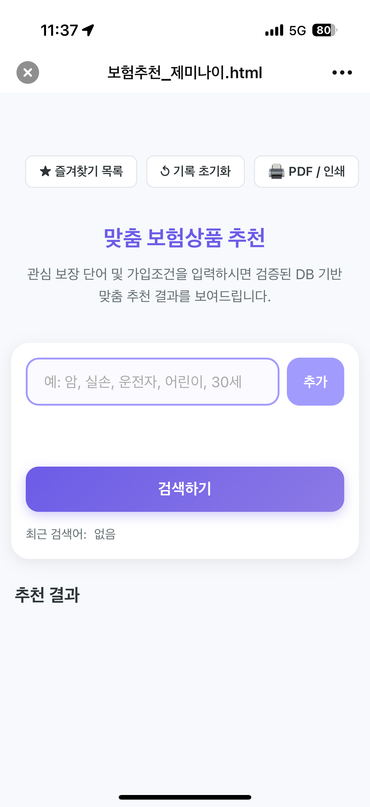
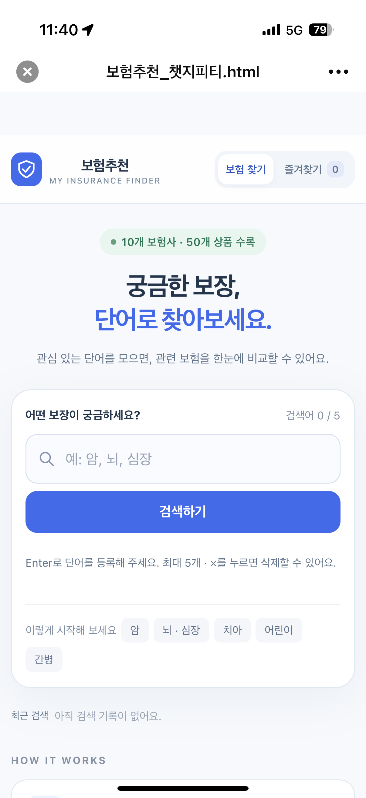

# HTML 비교 테스트 — 3번: 모바일에서 검색하기

- 프로젝트: 보험추천
- 요청한 문서 배치: `보험상품/미션 2-2/제작검증/비교테스트/html 테스트 .md`
- GitHub 저장소: `blue592/insurance-recommendation`
- GitHub 경로: `미션 2-2/제작검증/비교테스트/html 테스트 .md`
- 기록일: 2026-11-11
- 테스트 참여자: 사용자 본인
- **실행 순서: 3번째 테스트(모바일 조건 변경)를 먼저 진행했다. 1·2번 사용자 테스트는 아직 진행하지 않았다.**
- AI A: ChatGPT · 6 Astra / `보험추천_챗지피티.html`
- AI B: Google Gemini / `보험추천_제미나이.html`
- 선택한 결과물: AI A(ChatGPT). 선택 여부와 모바일 테스트 통과 여부는 별도로 기록한다.

## 테스트 3 — 모바일 조건 변경

| 항목 | 내용 |
| --- | --- |
| 테스트 내용 | 모바일에서 각 HTML을 열고 검색어 등록·검색을 시도한다. |
| 예상 결과 | 모바일에서도 검색어를 등록하고 검색하여 추천 결과를 확인할 수 있다. |
| AI A 실제 결과 | 사용자 보고: 모바일에서 Enter를 하지 못해 검색을 진행하지 못했다. |
| AI B 실제 결과 | 사용자 보고: 모바일에서 Enter를 하지 못해 검색을 진행하지 못했다. |
| 판정 | **두 결과물 모두 이번 모바일 사용 환경에서 검색 작업 실패.** |
| 원인 | 미확인. 키보드 조작, 파일을 연 앱, JavaScript 실행 환경, 입력·버튼 이벤트 등을 구분하여 확인해야 한다. |
| 수정·재테스트 | 미진행. 이번 작업은 기록 반영이며 HTML은 수정하지 않았다. |

### 사용자 원문

> 챗지피티와 제미나이 모두 모바일에서는 엔터를 못해서 검색을 못함.

> 3번째 테스트를 먼저해본거야.

- 사용자가 입력하려던 단어, 누른 버튼 순서, 키보드 상태 및 정확한 파일 열기 앱은 전달되지 않아 만들어 적지 않았다.
- 정지 캡처에는 키보드와 조작 과정이 보이지 않는다. 따라서 ‘검색 실패’는 사용자의 실제 경험 보고이고, Enter 입력 실패의 기술적 원인을 캡처만으로 확인한 것은 아니다.
- 이 결과를 모든 모바일 브라우저에서 동일하게 발생한다고 일반화하지 않는다.

## 캡처에서 확인한 내용

| 구분 | AI A: ChatGPT | AI B: Gemini |
| --- | --- | --- |
| 원본 캡처 | IMG_0688.png | IMG_0687.png |
| 캡처 상단 파일명 | 보험추천_챗지피티.html | 보험추천_제미나이.html |
| 첫 화면 | 보험 찾기·즐겨찾기, 검색 입력란과 검색하기 버튼 표시 | 즐겨찾기·기록 초기화·PDF/인쇄, 검색 입력란과 추가·검색하기 버튼 표시 |
| 검색 등록 상태 | 검색어 0 / 5, Enter로 등록하라는 안내 표시 | 등록된 검색어 칩 없음, 최근 검색어 ‘없음’ |
| 결과 상태 | 캡처 범위에 검색 결과 없음 | 추천 결과 영역에 카드 없음 |
| 화면 관찰 범위 | 보이는 검색창·검색하기 버튼은 화면 안에 있음 | 보이는 검색창·추가·검색하기 버튼은 화면 안에 있음 |

**첫 화면이 보인다는 사실은 검색 기능의 정상 동작을 뜻하지 않는다.** 캡처 범위 밖의 결과·비교표·상세보기와 다른 화면 폭의 잘림 여부는 확인하지 않았다.

Gemini에는 ‘추가’ 버튼이 보인다. 따라서 ‘두 제작본 모두 추가 버튼이 없어서 검색할 수 없다’고 기록하지 않는다. 추가 버튼을 눌렀는지, 눌렀을 때 반응했는지는 현재 자료로 확인되지 않는다.

### AI B — Gemini 모바일 캡처

[IMG_0687.png 원본 열기](IMG_0687.png)

### AI A — ChatGPT 모바일 캡처

[IMG_0688.png 원본 열기](IMG_0688.png)

## 테스트 순서와 후속 기록

| 사용자 테스트 번호 | 내용 | 현재 상태 |
| --- | --- | --- |
| 1 | 기본 환경에서 HTML 파일 열기 | 아직 진행하지 않음 |
| 2 | 한 단어·여러 단어 검색 | 아직 진행하지 않음 |
| **3** | **모바일 조건으로 변경하여 사용** | **가장 먼저 진행. A·B 모두 검색 진행 실패를 보고함** |

- 앞서 AI가 수행한 JavaScript 로직 검증은 별도 검증이다. 이를 사용자의 1·2번 테스트 완료로 바꾸어 기록하지 않는다.
- 모바일에서 파일의 첫 화면이 표시된 관찰은 3번 테스트에 속한다. 이것만으로 1번 테스트를 별도로 완료한 것으로 처리하지 않는다.
- 사용자가 추가 검증이나 수정을 진행하면 실제 입력·동작·결과를 이어서 적는다.

## 제작검증기록 반영 문구

> **테스트 3을 먼저 진행했다.** 모바일에서 ChatGPT와 Gemini HTML의 첫 화면은 표시됐지만, 사용자는 두 파일 모두 Enter로 검색어를 등록하지 못해 검색을 진행할 수 없었다고 보고했다. 이에 두 결과물의 모바일 검색 테스트는 실패로 기록한다. 원인과 수정 후 결과는 아직 확인하지 않았다. 1·2번 사용자 테스트는 미실시이다.

