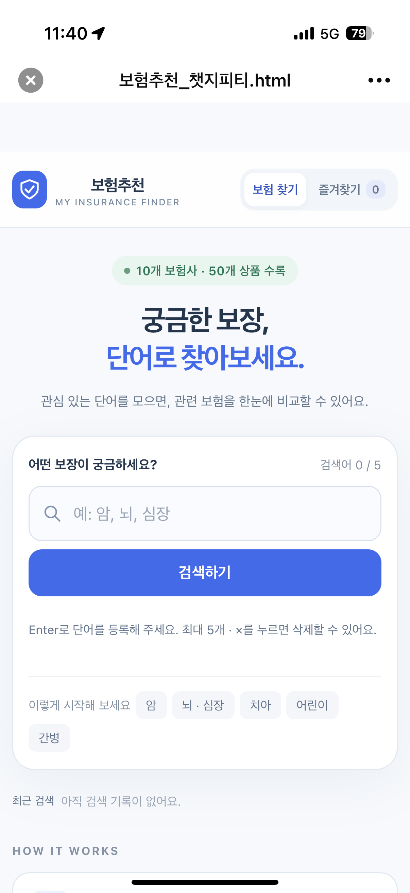
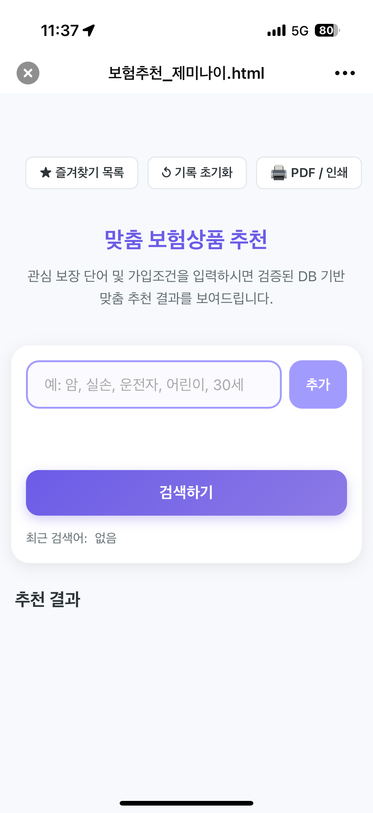
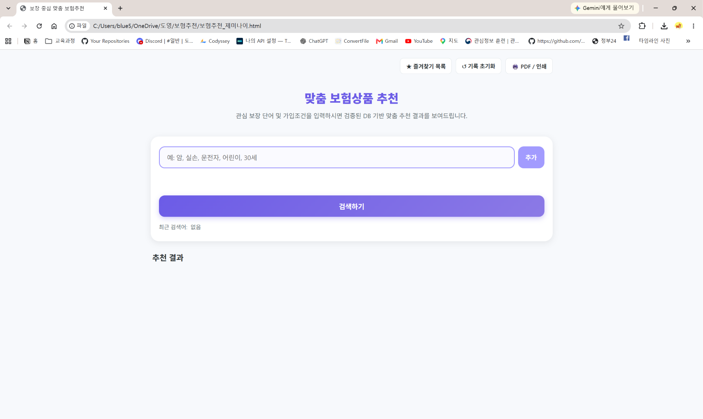
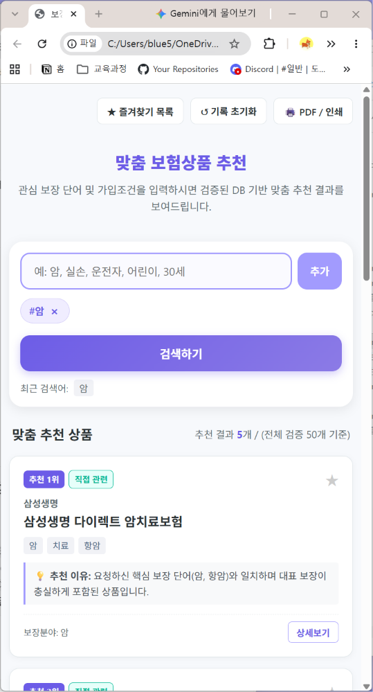
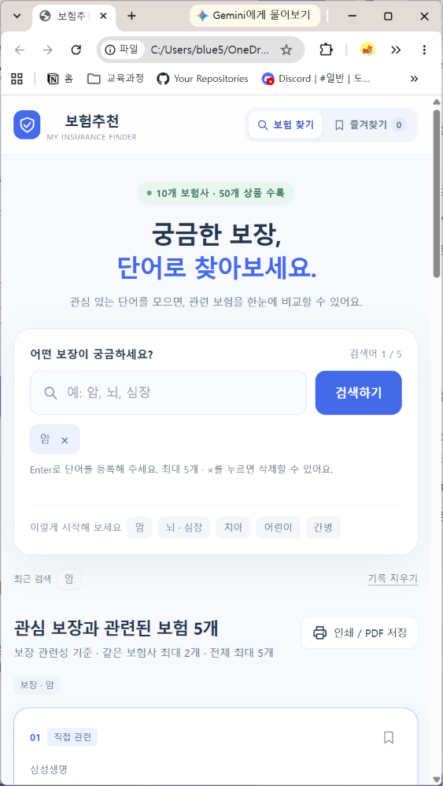
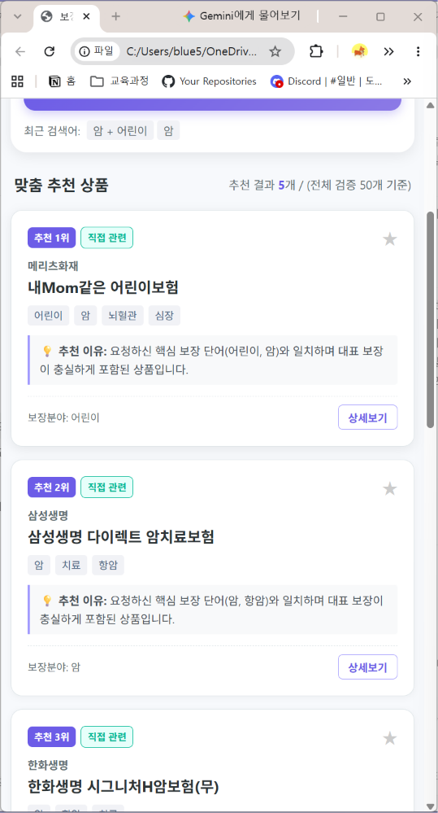
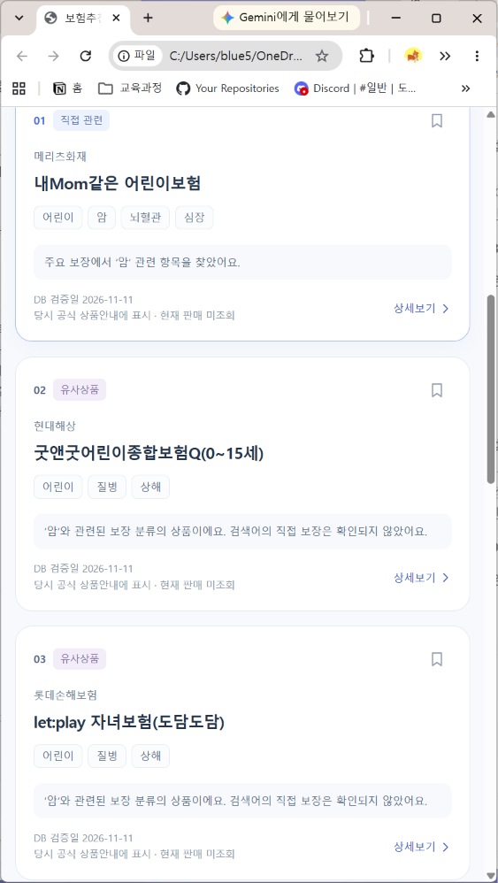

# 제작·검증 기록: 보험추천 — ChatGPT와 Gemini 비교

> 검증 자료: 사용자가 제공한 PC 브라우저 화면 캡처 **20장(10쌍)**. 화면에 표시된 결과를 근거로 작성했다. 화면 캡처만으로 확인할 수 없는 동작·원인은 단정하지 않는다.

## 1. 두 AI 및 제작 조건

- **AI A:** ChatGPT · GPT-6 Astra (사용자 제공 명칭) — `보험추천_챗지피티.html`
- **AI B:** Google Gemini · 세부 모델명 미확인 — `보험추천_제미나이.html`
- **공통 요청:** 동일 기획서와 보험상품 DB를 첨부하여 각각 기획서대로 단일 HTML 보험추천 페이지를 제작하도록 요청했다.
- **기획서 완료 기준:** 단일 HTML 실행, 한 단어 검색 추천 최대 5개, 여러 단어 검색 추천 최대 5개, 좁거나 넓은 화면에서 잘리지 않는 배치. 관련 후보가 부족하면 실제 후보 수와 안내를 표시하는 방식으로 판단한다.

## 2. 비교 매트릭스

| 검증 항목 | ChatGPT (AI A) | Gemini (AI B) | 판정 및 근거 |
| --- | --- | --- | --- |
| 로컬 HTML 첫 화면 | 브라우저의 `파일` 경로에서 열리고 검색창·검색 버튼·즐겨찾기 및 안내 표시 | 브라우저의 `파일` 경로에서 열리고 입력창·추가·검색 버튼 표시 | **둘 다 통과** — 서버 없이 파일로 실행한 화면 확인 |
| 검색어 등록 | Enter 안내 및 태그 등록 화면 확인 | `추가` 버튼과 태그 등록 화면 확인 | **둘 다 등록 가능** — 모바일 Enter 조작 실패 제보와는 별개 |
| 한 단어 `화상` | 0개, 일치 상품 없음 안내와 검색어 수정 버튼 | 0개, 일치 상품 없음 안내 | **둘 다 0개** — 존재해야 할 상품이 있었는지는 DB 검증 필요 |
| 여러 단어 `화상 + 감기` | 0개, 조건 불일치 안내 | 0개, 조건 불일치 안내 | **둘 다 0개** — 여러 단어 처리 자체는 확인 |
| 한 단어 `암` | 추천 5개 표시 | 추천 5개 표시 | **둘 다 통과** — 추천 개수 확인. 상품별 적합성은 별도 확인 필요 |
| 여러 단어 `암 + 어린이` | 추천 5개, 직접 관련·유사상품 구분 및 DB 검증일 표시 | 추천 5개, 순위와 추천 이유 표시 | **둘 다 5개 표시** — 두 AI의 후보 선정·표시 기준은 다름 |
| `강아지` 관련성 | 반려동물 상품 1개만 표시, 조건 일치 이유 제공 | 운전자보험 등을 포함해 5개 표시 | **ChatGPT 우세** — Gemini 결과에서 검색어와 무관한 상품이 보임 |
| 결과 부족·0개 안내 | 0개 결과 이유, 수정 버튼, 실제 개수 표기 | 0개 및 검색어 변경 안내 | **둘 다 안내** — ChatGPT의 수정 동선이 더 명확함 |
| 빈 입력 | `검색어를 입력해 주세요` 메시지. 기존 결과는 '이전 검색 결과'로 안내 | 입력창은 비어 있으나 이전 검색 결과와 갱신 안내가 나타남 | **ChatGPT의 오류 안내가 더 명확** — Gemini의 빈 입력 처리 여부는 추가 검증 필요 |
| 좁은 화면 | 검색창·버튼·태그·결과 영역 배치 확인 | 입력창·추가·검색 버튼·결과 카드 배치 확인 | **둘 다 화면 내 주요 UI 표시** — 실제 휴대전화 브라우저 테스트와는 구별 |
| 인쇄/PDF | 브라우저 인쇄 미리보기 2쪽 표시 | 브라우저 인쇄 미리보기 2쪽 표시 | **둘 다 인쇄 미리보기 진입** — 실제 파일 저장·출력물 확인은 미실시 |
| 추가 기능 | 검색 기록, 즐겨찾기, 관련성 배지, 검증일 및 판매 미조회 안내 | 즐겨찾기 목록, 기록 초기화, PDF/인쇄, 순위·추천 이유 | **기본 기능 외 보조 기능 다수** — 각 버튼의 전체 동작 검증은 미실시 |

### 선택한 결과물과 근거

**ChatGPT의 `보험추천_챗지피티.html` 선택.** `강아지` 검색에서 관련 반려동물 상품만 1개 제시했고, `암 + 어린이`에서는 직접 관련과 유사상품을 구분했다. 단순히 다섯 개를 채우기보다는 검색어와 관련 없는 결과를 제외하는 것이 사용자에게 더 유용하다. 다만 `화상`처럼 추천 0개인 경우 실제 DB에 일치 후보가 없는지 검증해야 한다.

## 3. 테스트 기록

| 번호 | 사용자 테스트 | 예상 결과 | 캡처로 확인한 실제 결과 |
| --- | --- | --- | --- |
| 1 | HTML 파일 직접 열기 | 로그인·서버 없이 첫 화면 표시 | 양쪽 모두 로컬 `파일` 주소로 첫 화면 열림 — **통과** |
| 2 | `암` 한 단어 검색 | 관련 상품 최대 5개 | 양쪽 모두 5개 표시 — **개수 통과**, 내용의 적합성은 추가 확인 |
| 3 | `화상` 한 단어 검색 | 관련 후보 표시 또는 부족 안내 | 양쪽 모두 0개와 부족 안내 — **안내 통과**, DB 누락 여부 미확인 |
| 4 | `화상 + 감기` 여러 단어 | 여러 단어 반영 및 후보 수 표시 | 양쪽 모두 0개 표시 — **처리 확인**, 검색 정확도 미확인 |
| 5 | `암 + 어린이` 여러 단어 | 관련 추천 최대 5개 | 양쪽 모두 5개 표시, 추천 근거·구성 차이 존재 |
| 6 | `강아지` 검색 | 반려동물 관련 상품만 추천 | ChatGPT 1개 반려동물 상품, Gemini 5개 중 운전자보험 노출 — **Gemini 관련성 문제 발견** |
| 7 | 입력창 비운 상태 | 빈 검색어 안내, 오래된 결과와 구분 | ChatGPT 명시적 오류 안내, 양쪽 모두 이전 결과가 남는 장면 확인 |
| 8 | 브라우저 창 너비 축소 | 가로 잘림 없이 검색·결과 사용 | 양쪽의 주요 구성 요소가 좁은 창에서 보임. 기기별 스크롤·터치 동작은 미검증 |
| 9 | 인쇄/PDF 버튼 | 결과가 인쇄 미리보기에 표시 | 양쪽 모두 2쪽 미리보기 표시. 실제 PDF 저장 완료 여부는 미확인 |
| 10 | 휴대전화에서 Enter로 검색어 등록(앞선 사용자 제보) | 키보드로 태그 등록 후 검색 | 양쪽 모두 등록 실패 제보. 이번 PC 캡처에서는 등록·검색 가능하므로 환경별 차이 원인 조사 필요 |

## 3-1. 모바일 실사용 비교테스트 (2026-11-11)

> 출처: [비교테스트/html 테스트 .md](비교테스트/html%20테스트%20.md), [ChatGPT 모바일 캡처](비교테스트/IMG_0688.png), [Gemini 모바일 캡처](비교테스트/IMG_0687.png). 사용자가 **테스트 3번을 먼저 진행**한 기록이며, 앞의 PC 화면 캡처 테스트와는 별도다.

### 사용자 보고와 판정

> 👤 사용자: “챗지피티와 제미나이 모두 모바일에서는 엔터를 못해서 검색을 못함.”

> 👤 사용자: “3번째 테스트를 먼저해본거야.”

| 항목 | ChatGPT (AI A) | Gemini (AI B) |
| --- | --- | --- |
| 실행 파일 | `보험추천_챗지피티.html` | `보험추천_제미나이.html` |
| 모바일 첫 화면 | 검색 입력란·검색하기 버튼·즐겨찾기 표시 | 검색 입력란·추가·검색하기 버튼·즐겨찾기 표시 |
| 캡처에서 보이는 검색어 등록 | `검색어 0 / 5`, Enter 등록 안내 | 등록된 검색어 칩 없음, 최근 검색어 없음 |
| 검색 작업 | 사용자가 Enter로 등록하지 못해 검색 진행 실패 보고 | 사용자가 Enter로 등록하지 못해 검색 진행 실패 보고 |
| 판정 | **이번 모바일 환경에서 실패** | **이번 모바일 환경에서 실패** |
| 원인 / 수정 후 재시험 | 미확인 / 미실시 | 미확인 / 미실시 |

| ChatGPT 모바일 첫 화면 | Gemini 모바일 첫 화면 |
| --- | --- |
|  |  |

**해석과 한계:** 두 파일 모두 첫 화면은 열렸지만, 이것이 검색 기능의 동작을 입증하지는 않는다. Gemini에는 별도 `추가` 버튼이 표시되므로 버튼 부재가 원인이라고 단정할 수 없다. 실제 입력 단어, 버튼 조작 순서, 키보드 상태, 파일을 연 앱은 확인되지 않았다. 키보드·이벤트 처리·실행 환경 중 어느 것이 문제인지도 미확인이다. 모든 모바일 기기에서 같은 문제가 발생한다고 일반화하지 않는다.

**테스트 순서:** 모바일 조건의 테스트 3번을 먼저 진행했다. 원본 기록 작성 시 사용자 테스트 1·2번은 미실시였으며, 이후 제공된 PC 화면 캡처 10쌍은 별도의 비교자료다. 따라서 PC 캡처 결과를 당시 모바일 테스트의 성공으로 소급하지 않는다.

**후속 확인:** 동일한 단어로 모바일에서 Enter와 버튼 등록을 각각 시도하고, 한 단어·여러 단어 검색 결과 및 화면 잘림을 확인해야 한다. 수정 기록 1의 모바일 입력 개선은 아직 적용되지 않았다.

## 4. 화면 캡처 나란히 비교

왼쪽은 **ChatGPT**, 오른쪽은 **Gemini**. 각 이미지는 클릭하여 원본 크기로 확인할 수 있다. 원본 사진은 같은 폴더의 `비교사진`에 보존했다.

| 항목 | ChatGPT (AI A) | Gemini (AI B) |
| --- | --- | --- |
| ① HTML 직접 열기 |  |  |
| ② 한 단어 태그 등록 |  |  |
| ③ `화상` 0개 |  |  |
| ④ `화상 + 감기` |  |  |
| ⑤ 인쇄/PDF 미리보기 |  |  |
| ⑥ 좁은 화면 |  |  |
| ⑦ `강아지` 검색 |  |  |
| ⑧ 빈칸 입력 |  |  |
| ⑨ `암` 5개 |  |  |
| ⑩ `암 + 어린이` |  |  |

## 5. 기획서 대비 구현 비교

| 항목 | ChatGPT | Gemini | 해석 |
| --- | --- | --- | --- |
| 단일 HTML 실행 | 확인 | 확인 | 완료 기준 충족 |
| 한 단어 추천 최대 5개 | 확인 | 확인 | `암` 5개, `화상` 0개 사례 |
| 여러 단어 추천 최대 5개 | 확인 | 확인 | `암 + 어린이` 5개, `화상 + 감기` 0개 |
| 반응형 화면 | PC 좁은 창에서 확인 | PC 좁은 창에서 확인 | 실제 휴대전화 조작은 재검증 필요 |
| 관련성·가입조건 필터 | `강아지` 관련성 좋은 사례 | `강아지` 관련성 오류 사례 | 전체 상품과 가입조건에 대한 코드·DB 검사는 별도 필요 |
| 즐겨찾기·검색 기록·인쇄 | 버튼·일부 화면 확인 | 버튼·일부 화면 확인 | 추가 기능으로 관찰됨. 전체 기능 검증 아님 |
| 외부 데이터 최신성·판매 여부 | '현재 판매 미조회' 문구 확인 | 캡처만으로 확인 불가 | 추천을 가입 가능·판매 중으로 단정하면 안 됨 |

## 6. ChatGPT 수정할 부분 3가지

### 수정 기록 1 — 모바일 검색어 등록

- **발견한 문제:** 사용자는 실제 모바일에서 Enter로 검색어를 등록하지 못했다고 보고했다. PC 캡처에서는 태그가 등록되므로 환경별 입력 방식 문제가 의심되지만 원인은 확정되지 않았다.
- **AI에게 전달할 요청:** “기존 기능과 검색 규칙은 유지하고, 아이폰·안드로이드 가상 키보드의 완료/Enter 입력과 별도 `추가` 버튼으로 모두 태그가 등록되도록 개선해 줘. 등록 후 `검색하기`까지 정상 동작해야 해.”
- **수정 후 테스트:** 미실시. 휴대전화에서 한 단어·여러 단어를 각각 입력·등록·검색하고 5개 이하 결과 및 안내를 재검증해야 한다.
- **수정 이유:** 검색어 등록에 막히면 앱의 핵심 기능을 사용할 수 없다.

### 수정 기록 2 — 0건 검색의 원인 안내·대체어

- **발견한 문제:** `화상`, `화상 + 감기` 모두 0개인데 검색어 불일치와 상품 DB에 해당 보장이 없는 상황을 사용자가 구별하기 어렵다.
- **AI에게 전달할 요청:** “0개 결과일 때 DB에서 일치하지 않은 이유를 확인 가능한 범위에서만 설명하고, 보장명 유사어·검색어 수정 예시를 보여줘. 관련 없는 상품으로 5개를 억지로 채우지 마.”
- **수정 후 테스트:** 미실시. `화상`, `화상 + 감기`, `암`으로 결과 개수 및 관련성 재검증 필요.
- **수정 이유:** 사용자가 0개 결과를 ‘해당 보험이 없다’로 오해할 수 있다.

### 수정 기록 3 — 검색 조건과 추천 근거 구분 강화

- **발견한 문제:** `암 + 어린이` 검색에서 직접 일치 상품과 보장 분류만 유사한 상품이 함께 표시된다. 어떤 단어와 실제로 일치하는지 더 선명하게 구분할 필요가 있다.
- **AI에게 전달할 요청:** “각 결과에 검색어별 일치 여부, 직접 관련/유사상품 사유, 가입연령 확인 여부를 분리 표시해 줘. 조건 미확인 상품은 가입 가능하다고 표현하지 말고, 관련 없는 상품은 제외해 줘.”
- **수정 후 테스트:** 미실시. `암 + 어린이`, `강아지`, `30세` 등으로 실제 필터가 정확한지 확인 필요.
- **수정 이유:** 단순 단어 유사도를 가입 가능성이나 실제 보장으로 착각하면 부적절한 보험을 선택할 수 있다.

## 7. 종합 평가

두 결과물 모두 HTML 직접 실행, 한·여러 단어 검색, 좁은 화면의 기본 배치, 인쇄 미리보기까지 확인되었다. **선택 기준은 결과 수보다 추천의 관련성**이었다. ChatGPT는 `강아지` 검색에서 관련 상품만 남겼으나 Gemini는 무관한 운전자보험을 포함해 5개를 제시했다. 따라서 ChatGPT를 후속 수정 대상으로 채택한다.

다만 캡처는 특정 시점의 화면만 보여준다. 상품 50개의 최신 공시 정확성, 전체 가입연령 조건, 실제 PDF 파일 저장, 모바일 터치·키보드 동작은 이 자료만으로 검증 완료라고 할 수 없다. **위 세 수정 항목은 계획 단계이며 수정 완료 또는 재테스트 통과로 기록하지 않는다.**

