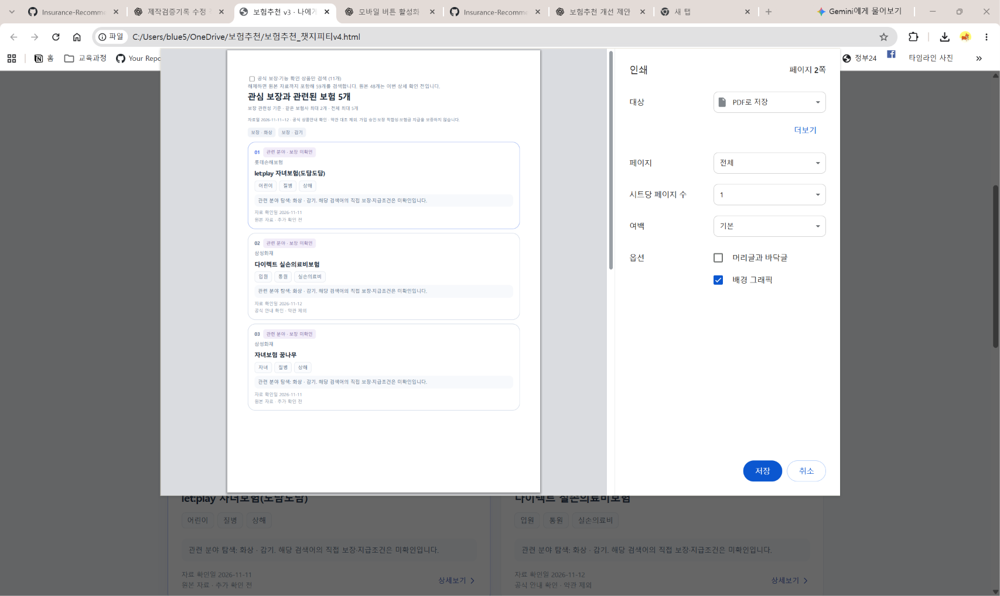

# 검색어 없음 수정 후 테스트

- 기록일: 2026-11-12 (한국 기준)
- 최초 수정 대상: [보험추천_챗지피티v3.html](../보험추천_챗지피티v3.html)
- 추가 테스트 실행 파일명: [보험추천_챗지피티v4.html](../보험추천_챗지피티v4.html) — 추가 사진의 주소 표시줄 기준
- 증거: 사용자가 제공한 PC Chrome 화면 캡처 2장 — 기존 단일 검색 1장 + 추가 복수 검색 1장
- 방식: 사용자 테스트 보고 및 캡처 판독. AI가 PC에서 직접 재현한 테스트가 아님.
- 범위: 약관 대조 제외. 추천 결과 표시와 직접 보장 미확인 안내를 확인하며, 실제 보장·보험금 지급을 확정하지 않음.

## 수정 전 문제와 사용자 불편

사용자가 앞선 PC 비교 테스트에서 `화상`, `화상+감기` 검색 결과가 0개라고 보고했다. 결과 없음 안내만으로는 어떤 단어로 다시 검색해야 하는지 알기 어려워 탐색을 중단할 수 있었다. 코드 점검에서는 요약 DB에 상세 보장 단어가 부족하고 `+`를 검색어 구분자로 처리하지 않는 문제가 확인됐다.

## 1차 사용자 테스트: 화상 단일 검색 (v3)

| 항목 | 예상 동작 | 캡처에서 보이는 결과 | 판정 범위 |
| --- | --- | --- | --- |
| 검색어 등록 | `화상`이 등록한 검색어로 표시 | 검색어 칩 `화상`과 결과 태그 `보장 · 화상` 표시 | 표시 확인 |
| 검색 대상 | 공식 보장·기능 확인 상품만 검색 | 체크박스 선택 및 `(11개)` 표시 | 선택 상태 확인 |
| 결과 표시 | 확인된 관련 분야가 있으면 그 수만 표시 | `관심 보장과 관련된 보험 1개` 표시 | 결과 1개 표시 확인 |
| 직접 보장 미확인 안내 | 화상 직접 보장이 확인되지 않았음을 안내 | `직접 보장 문구 미확인: 화상. 관련 분야 결과와 구분해 확인하세요.` 표시 | 안내 표시 확인 |
| 결과 분류 | 자료 문구 일치와 관련 분야를 구분 | 카드에 `관련 분야 · 보장 미확인` 표시 | 분류 표시 확인 |
| 표시 상품 | 관련 분야 후보를 카드로 표시 | 삼성화재 `다이렉트 실손의료비보험`, 입원·통원·실손의료비 표시 | 상품 카드 표시 확인 |
| 근거 안내 | 관련 분야 탐색이며 직접 보장·지급조건은 미확인임을 설명 | `관련 분야 탐색: 화상. 해당 검색어의 직접 보장·지급조건은 미확인입니다.` 표시 | 설명 표시 확인 |
| 다음 검색어 안내 | 사용자가 선택할 예시 제공 | 화상·감기·건강검진·폴립·손목·코로나 등 예시 버튼 표시 | 버튼 표시만 확인 |

### 1차 캡처에서 확인하지 않은 사항

- 캡처만으로 단어추가·검색 버튼을 누르는 과정, 예시 버튼의 실제 클릭 성공 여부는 확인할 수 없다.
- 1차 캡처에서는 최근 검색 목록에 다른 단어가 보이더라도 `화상+감기` 조합의 검색 결과까지 확인하지 못했다. 이후 확보한 복수 검색 결과는 아래 2차 사용자 테스트에 별도로 기록한다.
- 추천 1개가 보인다고 화상 보장·지급조건이 검증됐거나 5개 추천 완료 기준을 통과했다는 뜻은 아니다.
- 인쇄·이미지 저장 버튼은 보이지만 클릭·파일 저장 성공 여부는 미확인이다.
- 상세보기·즐겨찾기·초기화·모바일·다른 화면 폭·다른 검색어의 성공은 이번 캡처로 판정하지 않는다.
- 검색 표현 사전은 `500개 보기`라는 안내가 보일 뿐, 이번 캡처에서 사전 전체를 펼쳐 검증하지 않았다.
- PC 사용자 캡처는 AI의 실제 브라우저 자동화 검사와 구분한다.

### 1차 판단

**1차 PC 사용자 캡처에서는 `화상` 검색 결과가 0개 대신 관련 분야 1개로 표시되고, 직접 보장 미확인 안내와 다른 검색어 예시가 함께 표시되는 것을 확인했다.** 직접 보장 발견 또는 전체 기능·모든 상품 검증 완료로 기록하지 않는다.

### 1차 원본 캡처

- 첨부 파일명: `검색후 결과값없음 수정 테스트.png`
- 원본 이미지는 수정 없이 보관한다. 브라우저 주소창의 로컬 경로는 상품·보장 검증 근거로 사용하지 않는다.
- 관련 대화: [검색어 없음 수정 대화내용.md](<../대화캡쳐내역/검색어 없음 수정 대화내용.md>)
- 공유 링크: https://chatgpt.com/share/6af500e9-4a50-83e8-bb08-584d7f93c719

## 2차 사용자 테스트: 화상 + 감기 복수 검색 결과 확인

- 추가 기록일: 2026-11-12 (한국 기준)
- 테스트 환경: 사용자 PC Chrome에서 로컬 HTML 파일 실행
- 실행 파일명: [보험추천_챗지피티v4.html](../보험추천_챗지피티v4.html)
- 확인 근거: 사용자의 검색 결과 확인과 추가 캡처 1장

### 사용자가 확인한 결과

> 👤 나: 화상 +감기로 검색했을때 결과물이 나왔어 .

사용자가 `화상`과 `감기`를 함께 검색한 뒤 결과가 표시되었다고 확인했다. 추가 사진은 브라우저 주소 표시줄에 `보험추천_챗지피티v4.html`이 표시되어 있으므로, 검색어 없음 문제의 수정 후 동작을 **v4 파일명으로 실행한 화면에서 확인한 추가 기록**이다. 브라우저 탭 제목에는 “보험추천 v3”가 보이지만, 이번 사진을 v3 파일 자체의 재실행 근거로 사용하지 않는다.

### 검색 조건 및 확인 결과

| 항목 | 예상 동작 또는 확인할 내용 | 사용자 보고·사진에서 확인한 결과 | 판정 범위 |
| --- | --- | --- | --- |
| 복수 검색어 | 화상과 감기가 검색 조건에 함께 반영됨 | 사용자가 두 단어로 검색했다고 보고했고, 결과 상단에 `보장 · 화상`, `보장 · 감기` 태그가 보임 | 두 검색어가 표시된 결과 확인 |
| 검색 대상 옵션 | 검색 대상 범위를 확인함 | `공식 보장·기능 확인 상품만 검색 (11개)` 체크박스가 해제되어 있고, 원본 자료를 포함해 59개를 검색한다는 안내가 보임 | 1차의 확인 상품만 검색하는 조건과 구분 |
| 결과 표시 | 관련 분야 후보가 있으면 검색 결과가 표시됨 | `관심 보장과 관련된 보험 5개`라는 제목이 표시됨 | 해당 조건에서 결과 표시 확인, 제목의 개수는 5개 |
| 실제로 보이는 카드 | 결과 카드 내용을 확인함 | 첫 페이지에서 01~03번 카드 3개가 보임 | 4·5번 카드와 두 번째 페이지 내용은 미확인 |
| 보장 안내 | 관련 분야 결과와 직접 보장 확인 여부를 구분함 | 카드에 `관련 분야 · 보장 미확인` 및 직접 보장·지급조건 미확인 안내가 표시됨 | 결과 표시와 실제 보장 확인을 구분 |
| 인쇄 미리보기 | 검색 결과를 인쇄 미리보기로 볼 수 있음 | Chrome 인쇄 대화상자와 결과 미리보기가 열려 있음 | 인쇄 미리보기 표시 확인 |
| PDF 저장 설정 | PDF 저장 대상을 선택할 수 있음 | 대상이 `PDF로 저장`이고 전체 분량이 `2쪽`으로 표시됨 | 저장 설정 화면 확인. 파일 저장 완료는 미확인 |

### 첫 페이지에서 확인한 상품 카드

| 번호 | 보험회사 | 화면에 표시된 상품명 |
| --- | --- | --- |
| 01 | 롯데손해보험 | let:play 자녀보험(도담도담) |
| 02 | 삼성화재 | 다이렉트 실손의료비보험 |
| 03 | 삼성화재 | 자녀보험 꿈나무 |

위 표는 사진에 보이는 상품명을 기록한 것이다. 화상·감기에 대한 실제 보장이나 보험금 지급조건을 검증한 목록은 아니다.

### 이번 추가 테스트의 확인 범위

- **확인:** 사용자가 화상 + 감기로 검색한 뒤 결과가 나왔다고 보고했으며, 사진에도 두 검색어와 `보험 5개` 제목, 첫 페이지 카드 3개가 표시된다. 따라서 해당 조건에서 검색 결과가 표시되는 동작을 확인했다.
- **조건 차이:** 1차 사진은 확인 상품만 검색하는 옵션이 선택된 상태이고, 추가 사진은 해제된 상태다. 검색어 조합·실행 파일명·검색 대상 옵션이 달라 결과 개수 차이를 특정 수정 하나의 효과로 단정하지 않는다.
- **인쇄 확인:** PC Chrome의 인쇄 미리보기와 PDF 저장 설정 화면이 열린 상태까지 확인했다. 저장 버튼을 누른 뒤 PDF 파일이 생성되고 정상적으로 열리는지는 확인하지 않았다.
- **추가 미확인:** 4·5번 카드 및 두 번째 페이지 내용, `+` 직접 입력 또는 단어별 등록의 실제 조작 과정, 다른 검색어 조합과 모바일 동작은 이번 사진으로 확인하지 않았다.

### 2차 판단

**기존의 화상 단일 검색 결과 1개 확인에 더해, 사용자가 화상 + 감기를 함께 검색했을 때 결과가 표시되었다는 추가 근거를 확보했다.** 추가 화면의 제목은 `관심 보장과 관련된 보험 5개`이며, PC 인쇄 미리보기도 열린 상태다. 이번 기록은 사진에서 확인한 실행 파일명과 검색 대상 조건을 함께 남기며, 실제 PDF 저장 완료·5개 카드 전체 내용·직접 보장 검증까지 통과한 것으로 확대하지 않는다.

### 2차 추가 캡처

- 사용자 첨부 파일명: `image(1).png`
- 저장 파일명: `검색어없음_화상_감기_검색결과_인쇄미리보기.png`
- 첨부 이미지의 내용은 수정하지 않고 파일명만 구분하여 보관한다.

