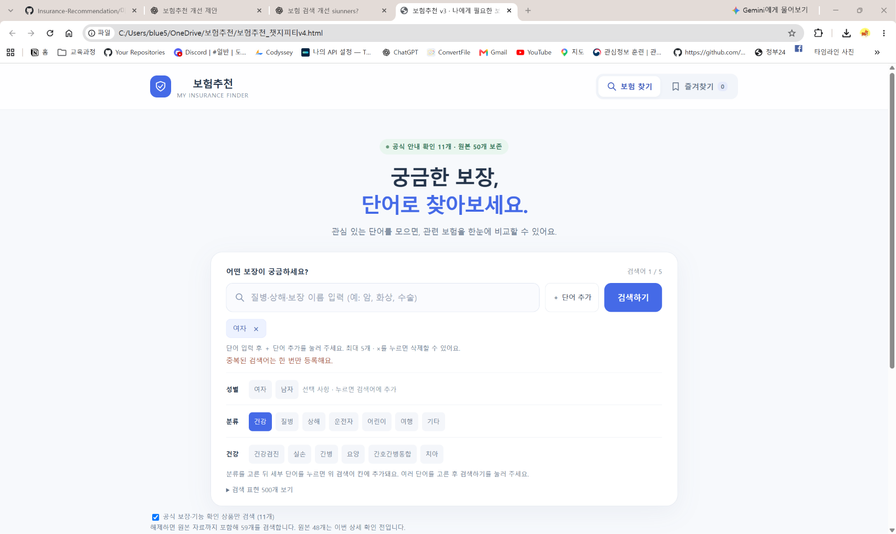
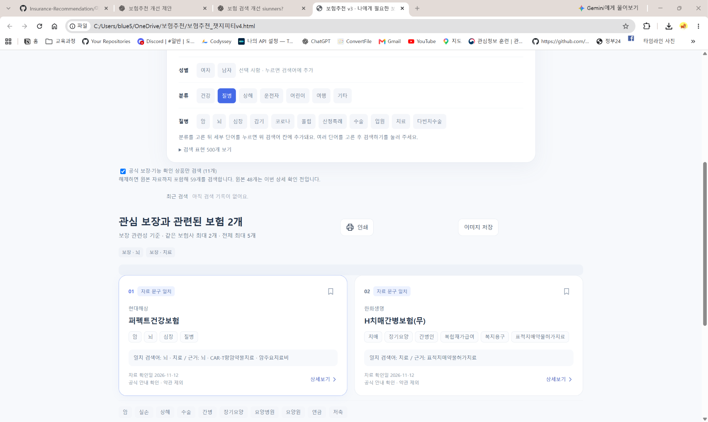

# 3.검색창 단어 예시 추가 수정 후 테스트

- 기록일: 2026-11-12
- 대상: [보험추천_챗지피티v4.html](../보험추천_챗지피티v4.html)
- 근거: 사용자가 제공한 PC Chrome 캡처 2장. AI가 직접 클릭하여 재실행한 테스트가 아닌 화면 판독 기록입니다.
- 주소창 파일명은 v4이며 브라우저 탭 제목은 v3로 남아 있습니다.

## 발견한 문제와 반영 내용

검색어 예시가 부족하여 보험에 익숙하지 않은 사용자가 입력할 단어를 떠올려야 했습니다. 검색창 안에 구체적인 안내를 표시하고, 성별 및 큰 분류와 세부 단어 버튼을 추가했습니다. 세부 단어는 기존 검색어 칸에 추가한 뒤 검색하는 방식으로 설계했습니다.

## 캡처에서 확인한 결과

| 항목 | 예상 결과 | 실제 확인 내용 | 확인 범위 |
| --- | --- | --- | --- |
| 검색창 안내 | 입력 예시 표시 | 질병·상해·보장 이름 입력 (예: 암, 화상, 수술) 표시 | 화면 표시 확인 |
| 성별 단어 등록 | 선택 단어가 검색어 칸에 등록 | 여자 칩 1개, 검색어 1 / 5 표시 | 등록 상태 확인, 클릭 과정 미확인 |
| 중복 안내 | 같은 단어 중복 등록 방지 안내 | 여자 칩 1개와 ‘중복된 검색어는 한 번만 등록해요.’ 표시 | 해당 화면 상태 확인 |
| 큰 분류 | 건강·질병·상해·운전자·어린이·여행·기타 표시 | 두 캡처에서 모두 표시 | 표시 확인 |
| 건강 세부 항목 | 건강 분류에 맞는 단어 표시 | 건강 활성 색과 건강검진·실손·간병·요양·간호간병통합·치아 표시 | 건강 선택 상태 확인 |
| 질병 세부 항목 | 질병 분류에 맞는 단어 표시 | 질병 활성 색과 암·뇌·심장·감기·코로나·폴립·산정특례·수술·입원·치료·다빈치수술 표시 | 질병 선택 상태 확인 |
| 여러 검색어 결과 | 검색어와 결과 표시 | 결과 요약에 ‘보장 · 뇌’, ‘보장 · 치료’, 관련 보험 2개 표시 | 결과 화면 확인, 입력·클릭 순서 미확인 |
| 결과 카드 | 상품명과 일치 근거 표시 | 현대해상 퍼펙트건강보험, 한화생명 H치매간병보험(무); 자료 문구 일치 및 근거 표시 | 카드 표시 확인 |

두 캡처에서 서로 다른 분류의 활성 색과 세부 항목을 확인했습니다. 분류 전환 과정 자체와 모든 분류의 동작을 확인한 것은 아닙니다. 뇌·치료 결과는 2개로 표시됐으므로 ‘5개 추천 성공’으로 기록하지 않습니다. 상품 문구 일치는 실제 가입 가능성·보장·보험금 지급 확정을 뜻하지 않습니다.

## 미확인 항목

- 세부 단어 클릭 → 검색어 추가 → 검색 버튼 실행의 연속 조작 과정
- 남자 선택, 다른 분류 전체, 직접 입력·Enter·단어 추가 버튼, × 삭제, 최대 5개 제한의 재검증
- 모바일 화면 및 터치 동작
- 상세보기·즐겨찾기·인쇄·이미지 저장 성공
- 모든 예시의 상품 매칭 및 상품 정보의 정확성

## 캡처 근거

### 캡처 1 — 질병 분류 및 뇌·치료 검색 결과

### 캡처 2 — 검색창 안내·여자 등록·중복 안내·건강 분류

## 정리

검색창 안내, 분류별 예시, 여자 검색어 등록 상태 및 중복 안내, 뇌·치료 검색 결과 2개를 사용자 PC 캡처에서 확인했습니다. 전체 기능 통과나 모바일 성공으로 확대 기록하지 않습니다.
