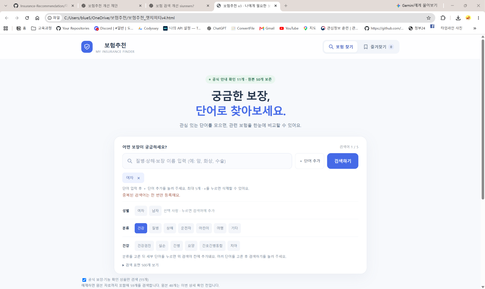
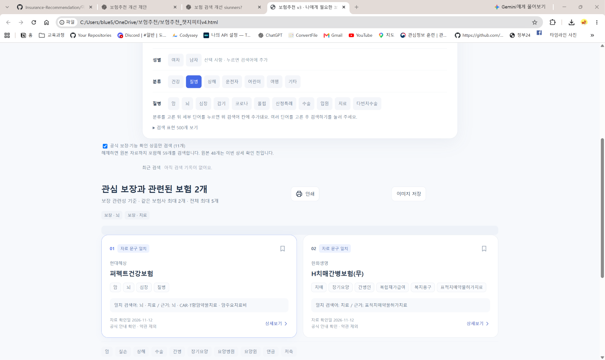

# 버전별 수정 기록

기존 수정 테스트 기록 3건을 순서대로 합친 문서입니다. 각 원본은 기존 경로에 보존하며, 원본에 있는 확인 결과와 미확인 사항을 함께 수록했습니다. 이 문서 작성 과정에서 추가 테스트는 수행하지 않았습니다.

| 수정 순서 | 수정 테스트 원본 | 버전 파일 경로 |
| --- | --- | --- |
| 첫번째 수정 | [모바일버튼_활성화 수정테스트 캡쳐.md](%EB%AA%A8%EB%B0%94%EC%9D%BC%EB%B2%84%ED%8A%BC_%ED%99%9C%EC%84%B1%ED%99%94%20%EC%88%98%EC%A0%95%ED%85%8C%EC%8A%A4%ED%8A%B8%20%EC%BA%A1%EC%B3%90.md) | [보험추천_챗지피티v2.html](../보험추천_챗지피티v2.html) |
| 두번째 수정 | [검색어 없음 수정 후 테스트.md](%EA%B2%80%EC%83%89%EC%96%B4%20%EC%97%86%EC%9D%8C%20%EC%88%98%EC%A0%95%20%ED%9B%84%20%ED%85%8C%EC%8A%A4%ED%8A%B8.md) | [보험추천_챗지피티v3.html](../보험추천_챗지피티v3.html) |
| 세번째 수정 | [검색창 단어 예시 추가 수정 후 테스트.md](%EA%B2%80%EC%83%89%EC%B0%BD%20%EB%8B%A8%EC%96%B4%20%EC%98%88%EC%8B%9C%20%EC%B6%94%EA%B0%80%20%EC%88%98%EC%A0%95%20%ED%9B%84%20%ED%85%8C%EC%8A%A4%ED%8A%B8.md) | [보험추천_챗지피티v4.html](../보험추천_챗지피티v4.html) |

## 첫번째 수정: 모바일버튼_활성화 수정테스트 캡쳐.md

- 버전: [보험추천_챗지피티v2.html](../보험추천_챗지피티v2.html)
- 수정 사항: 모바일에서 검색어를 등록하기 어려웠던 문제에 대응하여 단어 추가·검색 버튼과 터치 영역을 보완하고, 결과 이미지 생성·미리보기를 제공했습니다.

### 원본 기록 내용

- 기록일: 2026-11-12
- 대상: [보험추천_챗지피티v2.html](../보험추천_챗지피티v2.html)
- 근거: 사용자가 이 대화에 첨부한 모바일 화면 캡처 3장과 첨부 직후의 AI 확인 답변
- 범위: 캡처 판독 기록. 이번 문서 작성 중 별도의 기기 재시험은 수행하지 않았습니다.
- 원본 이미지 파일은 이 문서에 포함하지 않았습니다. 아래는 대화에서 확인한 캡처 내용의 텍스트 기록입니다.

### 수정 후 확인 결과

| 확인 항목 | 예상 결과 | 캡처에서 확인된 실제 결과 | 판정 |
| --- | --- | --- | --- |
| 검색어 등록 상태 | 여러 검색어가 등록되어 표시됨 | 암·뇌·심장 검색어가 등록되어 있음 | 표시 확인 |
| 검색 결과 | 보험상품 5개가 표시됨 | 검색 결과에 보험상품 5개가 표시됨 | 표시 확인 |
| 이미지 생성 | 이미지 저장 기능을 통해 결과 이미지가 생성됨 | ‘이미지 저장’ 이후 검색 결과 이미지 1장이 생성된 화면이 있음 | 이미지 생성·표시 확인 |
| 생성 이미지 내용 | 검색어·상품·보장 내용·안내가 포함됨 | 세 번째 캡처에 검색어·상품 5개·보장 내용·안내 문구가 잘리지 않고 담겨 있음 | 해당 캡처 범위에서 확인 |
| 사진 앱 저장 | 생성 이미지를 사진 앱에서 확인 가능 | 사진 앱에 실제 저장된 화면은 확인되지 않음 | 미확인 |
| 인쇄·PDF 저장 | 인쇄 화면 또는 저장된 PDF 확인 가능 | 해당 성공 증거는 확인되지 않음 | 미확인 |

검색어가 등록된 상태는 확인되지만, Enter·추가 버튼·예시 단어 클릭 중 어떤 입력 경로를 사용했는지는 캡처만으로 확정하지 않습니다. 모든 모바일 버튼과 기존 기능 전체가 정상이라는 판정으로 확대하지 않습니다.

### 대화 기록

#### 👤 나

> 모바일 테스트 화면 캡처 3장을 첨부함.

#### 🤖 AI

> 사진에서 **모바일 이미지 생성과 결과 표시가 되는 것**을 확인했어요.
>
> - 검색어 **암·뇌·심장**이 등록되어 있어요.
> - 검색 결과에 **보험상품 5개**가 표시돼요.
> - ‘이미지 저장’을 누른 뒤 **검색 결과 이미지 1장**이 생성됐어요.
> - 세 번째 사진에는 검색어·상품 5개·보장 내용·안내 문구가 잘리지 않고 담겨 있어요.
>
> 다만 **사진 앱에 실제 저장됐는지와 인쇄·PDF 저장이 작동하는지는 사진만으로 확인할 수 없어요.**

#### 👤 나

> 모바일버튼_활성화 수정테스트 캡쳐.md 로 커밋해줘

---

- 한 줄 요약: 모바일 캡처에서 검색어 등록 상태·상품 5개 표시·결과 이미지 생성을 확인했으며, 사진 앱 저장 및 인쇄·PDF 저장은 미확인으로 남겼습니다.
- 서비스모델명(사용자 지정 표기): 6 Astra Light
- 실제 작업 환경: Codex (세부 모델명은 이 기록에서 확정하지 않음)
- 관련 수정 대화 공유 링크(이전 제공): https://chatgpt.com/share/6af4fc90-9078-83ee-a049-817df03b767d
- 위 링크가 이번 테스트 캡처까지 포함하는지는 확인하지 않았습니다.

## 두번째 수정: 검색어 없음 수정 후 테스트.md

- 버전: [보험추천_챗지피티v3.html](../보험추천_챗지피티v3.html)
- 수정 사항: 검색 결과가 없을 때 다음 검색어를 찾기 어려웠던 문제에 대응하여 검색 표현과 구분자 처리를 보완하고, 관련 분야 결과·직접 보장 미확인 안내·검색 예시를 제공했습니다.

### 원본 기록 내용

- 기록일: 2026-11-12 (한국 기준)
- 대상: [보험추천_챗지피티v3.html](../보험추천_챗지피티v3.html)
- 증거: 사용자가 제공한 PC Chrome 화면 캡처 1장
- 방식: 사용자 캡처 판독. AI가 PC에서 직접 재현한 테스트가 아님.
- 범위: 약관 대조 제외. 추천 결과 표시와 직접 보장 미확인 안내를 확인하며, 실제 보장·보험금 지급을 확정하지 않음.

### 수정 전 문제와 사용자 불편

사용자가 앞선 PC 비교 테스트에서 `화상`, `화상+감기` 검색 결과가 0개라고 보고했다. 결과 없음 안내만으로는 어떤 단어로 다시 검색해야 하는지 알기 어려워 탐색을 중단할 수 있었다. 코드 점검에서는 요약 DB에 상세 보장 단어가 부족하고 `+`를 검색어 구분자로 처리하지 않는 문제가 확인됐다.

### 이번 캡처에서 확인한 테스트

| 항목 | 예상 동작 | 캡처에서 보이는 결과 | 판정 범위 |
| --- | --- | --- | --- |
| 검색어 등록 | `화상`이 등록한 검색어로 표시 | 검색어 칩 `화상`과 결과 태그 `보장 · 화상` 표시 | 표시 확인 |
| 검색 대상 | 공식 보장·기능 확인 상품만 검색 | 체크박스 선택 및 `(11개)` 표시 | 선택 상태 확인 |
| 결과 표시 | 확인된 관련 분야가 있으면 그 수만 표시 | `관심 보장과 관련된 보험 1개` 표시 | 결과 1개 표시 확인 |
| 직접 보장 미확인 안내 | 화상 직접 보장이 확인되지 않았음을 안내 | `직접 보장 문구 미확인: 화상. 관련 분야 결과와 구분해 확인하세요.` 표시 | 안내 표시 확인 |
| 결과 분류 | 자료 문구 일치와 관련 분야를 구분 | 카드에 `관련 분야 · 보장 미확인` 표시 | 분류 표시 확인 |
| 표시 상품 | 관련 분야 후보를 카드로 표시 | 삼성화재 `다이렉트 실손의료비보험`, 입원·통원·실손의료비 표시 | 상품 카드 표시 확인 |
| 근거 안내 | 관련 분야 탐색이며 직접 보장·지급조건은 미확인임을 설명 | `관련 분야 탐색: 화상. 해당 검색어의 직접 보장·지급조건은 미확인입니다.` 표시 | 설명 표시 확인 |
| 다음 검색어 안내 | 사용자가 선택할 예시 제공 | 화상·감기·건강검진·폴립·손목·코로나 등 예시 버튼 표시 | 버튼 표시만 확인 |

### 확인하지 않은 사항

- 캡처만으로 단어추가·검색 버튼을 누르는 과정, 예시 버튼의 실제 클릭 성공 여부는 확인할 수 없다.
- 최근 검색 목록에 다른 단어가 보이더라도 `화상+감기` 조합의 검색 결과가 검증된 것은 아니다.
- 추천 1개가 보인다고 화상 보장·지급조건이 검증됐거나 5개 추천 완료 기준을 통과했다는 뜻은 아니다.
- 인쇄·이미지 저장 버튼은 보이지만 클릭·파일 저장 성공 여부는 미확인이다.
- 상세보기·즐겨찾기·초기화·모바일·다른 화면 폭·다른 검색어의 성공은 이번 캡처로 판정하지 않는다.
- 검색 표현 사전은 `500개 보기`라는 안내가 보일 뿐, 이번 캡처에서 사전 전체를 펼쳐 검증하지 않았다.
- PC 사용자 캡처는 AI의 실제 브라우저 자동화 검사와 구분한다.

### 판단

**이번 PC 사용자 캡처에서는 `화상` 검색 결과가 0개 대신 관련 분야 1개로 표시되고, 직접 보장 미확인 안내와 다른 검색어 예시가 함께 표시되는 것을 확인했다.** 직접 보장 발견 또는 전체 기능·모든 상품 검증 완료로 기록하지 않는다.

### 원본 캡처

- 첨부 파일명: `검색후 결과값없음 수정 테스트.png`
- 원본 이미지는 수정 없이 보관한다. 브라우저 주소창의 로컬 경로는 상품·보장 검증 근거로 사용하지 않는다.
- 관련 대화: [검색어 없음 수정 대화내용.md](<../대화캡쳐내역/검색어 없음 수정 대화내용.md>)
- 공유 링크: https://chatgpt.com/share/6af500e9-4a50-83e8-bb08-584d7f93c719

## 세번째 수정: 검색창 단어 예시 추가 수정 후 테스트.md

- 버전: [보험추천_챗지피티v4.html](../보험추천_챗지피티v4.html)
- 수정 사항: 입력할 검색어를 떠올리기 어려웠던 문제에 대응하여 검색창 안내와 성별·분류별 세부 단어 예시를 추가했습니다.

### 원본 기록 내용

- 기록일: 2026-11-12
- 대상: [보험추천_챗지피티v4.html](../보험추천_챗지피티v4.html)
- 근거: 사용자가 제공한 PC Chrome 캡처 2장. AI가 직접 클릭하여 재실행한 테스트가 아닌 화면 판독 기록입니다.
- 주소창 파일명은 v4이며 브라우저 탭 제목은 v3로 남아 있습니다.

### 발견한 문제와 반영 내용

검색어 예시가 부족하여 보험에 익숙하지 않은 사용자가 입력할 단어를 떠올려야 했습니다. 검색창 안에 구체적인 안내를 표시하고, 성별 및 큰 분류와 세부 단어 버튼을 추가했습니다. 세부 단어는 기존 검색어 칸에 추가한 뒤 검색하는 방식으로 설계했습니다.

### 캡처에서 확인한 결과

| 항목 | 예상 결과 | 실제 확인 내용 | 확인 범위 |
| --- | --- | --- | --- |
| 검색창 안내 | 입력 예시 표시 | 질병·상해·보장 이름 입력 (예: 암, 화상, 수술) 표시 | 화면 표시 확인 |
| 성별 단어 등록 | 선택 단어가 검색어 칸에 등록 | 여자 칩 1개, 검색어 1 / 5 표시 | 등록 상태 확인, 클릭 과정 미확인 |
| 중복 안내 | 같은 단어 중복 등록 방지 안내 | 여자 칩 1개와 ‘중복된 검색어는 한 번만 등록해요.’ 표시 | 해당 화면 상태 확인 |
| 큰 분류 | 건강·질병·상해·운전자·어린이·여행·기타 표시 | 두 캡처에서 모두 표시 | 표시 확인 |
| 건강 세부 항목 | 건강 분류에 맞는 단어 표시 | 건강 활성 색과 건강검진·실손·간병·요양·간호간병통합·치아 표시 | 건강 선택 상태 확인 |
| 질병 세부 항목 | 질병 분류에 맞는 단어 표시 | 질병 활성 색과 암·뇌·심장·감기·코로나·폴립·산정특례·수술·입원·치료·다빈치수술 표시 | 질병 선택 상태 확인 |
| 여러 검색어 결과 | 검색어와 결과 표시 | 결과 요약에 ‘보장 · 뇌’, ‘보장 · 치료’, 관련 보험 2개 표시 | 결과 화면 확인, 입력·클릭 순서 미확인 |
| 결과 카드 | 상품명과 일치 근거 표시 | 현대해상 퍼펙트건강보험, 한화생명 H치매간병보험(무); 자료 문구 일치 및 근거 표시 | 카드 표시 확인 |

두 캡처에서 서로 다른 분류의 활성 색과 세부 항목을 확인했습니다. 분류 전환 과정 자체와 모든 분류의 동작을 확인한 것은 아닙니다. 뇌·치료 결과는 2개로 표시됐으므로 ‘5개 추천 성공’으로 기록하지 않습니다. 상품 문구 일치는 실제 가입 가능성·보장·보험금 지급 확정을 뜻하지 않습니다.

### 미확인 항목

- 세부 단어 클릭 → 검색어 추가 → 검색 버튼 실행의 연속 조작 과정
- 남자 선택, 다른 분류 전체, 직접 입력·Enter·단어 추가 버튼, × 삭제, 최대 5개 제한의 재검증
- 모바일 화면 및 터치 동작
- 상세보기·즐겨찾기·인쇄·이미지 저장 성공
- 모든 예시의 상품 매칭 및 상품 정보의 정확성

### 캡처 근거

#### 캡처 1 — 질병 분류 및 뇌·치료 검색 결과

#### 캡처 2 — 검색창 안내·여자 등록·중복 안내·건강 분류

### 정리

검색창 안내, 분류별 예시, 여자 검색어 등록 상태 및 중복 안내, 뇌·치료 검색 결과 2개를 사용자 PC 캡처에서 확인했습니다. 전체 기능 통과나 모바일 성공으로 확대 기록하지 않습니다.
